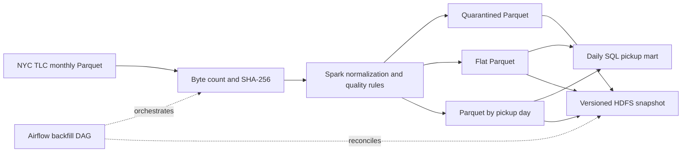
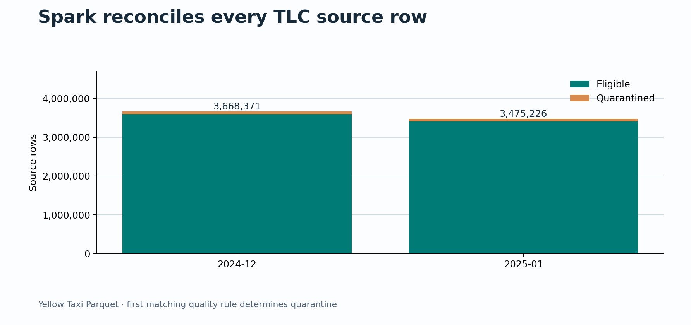
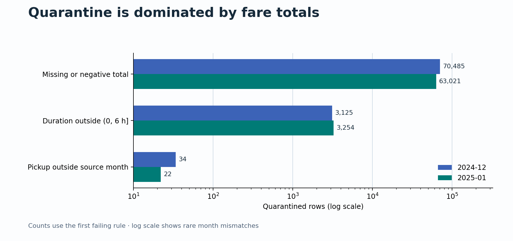
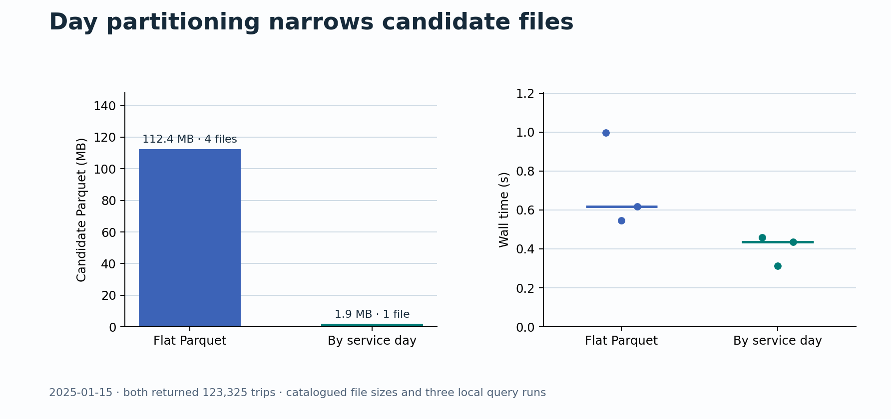

# NYC Trip Record Lakehouse

A versioned Spark SQL lakehouse for NYC Yellow Taxi records. The project tests how a monthly backfill handles a real schema change and whether day partitioning reduces the Parquet files selected by a daily pickup query. The two official snapshots contain 7.14 million records.

## Architecture



The [source manifest](data/manifest.json) pins the official December 2024 and January 2025 Yellow Taxi files. The December file lacks `cbd_congestion_fee`. January introduces that column, so the earlier entries preserve a null value. See the [NYC TLC data catalog and dictionary](https://www.nyc.gov/site/tlc/about/tlc-trip-record-data.page). Download the records from TLC under the applicable [NYC Open Data terms](https://a860-gpp.nyc.gov/downloads/9p290c02z?locale=en). This repository contains code and aggregate evidence.

## Quality and query results

Pickup and dropoff remain wall-clock timestamps as supplied. The service day comes from pickup. A trip can cross midnight if its pickup belongs to the source month. A row enters quarantine at the first failed rule. These rules gate the analytical snapshot and exclude missing or negative fare totals, durations outside (0, 6 h], invalid zone identifiers, invalid distances and cross-month pickups. Cash-flow or refund analysis would need a different policy.

| Source month | Total | Eligible | Quarantined | CBD fee field |
| --- | ---: | ---: | ---: | --- |
| 2024-12 | 3,668,371 | 3,594,727 | 73,644 | Absent |
| 2025-01 | 3,475,226 | 3,408,929 | 66,297 | Present |

The [daily SQL mart](queries/daily_pickups.sql) returned identical zone-level counts and exact decimal fare sums on January 15, 2025, covering 123,325 trips and 232 pickup zones. The partitioned plan contains a service-day partition filter.

| Layout | Files on disk | Candidate files for Jan 15 | Candidate file size | Median local query time |
| --- | ---: | ---: | ---: | ---: |
| Flat Parquet | 4 | 4 | 112.44 MB | 0.6174 s |
| By service day | 62 | 1 | 1.85 MB | 0.4358 s |

Candidate size is the total size of files eligible for the date predicate, before Parquet row-group or column pruning. The times are three sequential query measurements per layout on one Spark local runner. [Raw benchmark metrics](reports/spark-metrics.json) · [Flat plan](reports/plan-flat.txt) · [Partitioned plan](reports/plan-partitioned.txt)

## Visual results gallery







## Reproduce the Spark run

Requires Python 3.11+ on the host and Docker Compose. Commands run from the repository root.

```powershell
python fetch_tlc.py
New-Item -ItemType Directory -Path runs -Force
docker compose run --rm -T spark --master 'local[2]' --driver-memory 1g --conf spark.ui.enabled=false lakehouse.py --output runs/yellow-snapshot
python -m unittest discover -s tests -v
docker compose run --rm -T spark --master 'local[2]' --driver-memory 768m --conf spark.ui.enabled=false tests/check_spark.py
```

Repeat the same Spark command to check reuse of the committed output. Spark stages a new snapshot locally before an atomic directory rename. Existing outputs must match the source manifest and benchmark day and contain all three Spark success markers.

```powershell
python -m pip install -r requirements-visuals.txt
python plot_results.py --metrics runs/yellow-snapshot/metrics.json
```

## HDFS and Airflow profiles

HDFS 3.4.2 and Airflow 3.1.7 are isolated Compose profiles for the local backfill. The HDFS layout uses a single DataNode and one replica. The Airflow debug run uses SQLite and executes the three tasks serially. No services bind host ports.

```powershell
New-Item -ItemType Directory -Path runs -Force
docker compose --profile hdfs up -d --wait namenode datanode
docker compose --profile airflow build airflow
docker compose --profile airflow run --rm -T airflow bash -ec 'airflow db migrate && airflow dags test nyc_tlc_backfill 2025-01-15'
```

Airflow checks the source files, runs Spark and reconciles the HDFS snapshot. The local receipt is `runs/airflow-hdfs.json`. Repeat the same command to validate reuse of the Spark and HDFS snapshots. Stop the two HDFS services with `docker compose --profile hdfs stop datanode namenode`. The named volumes persist between runs.

The first run read back 7,003,656 eligible rows and 139,941 quarantined rows from HDFS. The two HDFS layouts reproduced the local daily pickup mart. On rerun, Airflow completed all three tasks, reused the same HDFS version and returned identical counts and fare sums. [First run receipt](reports/hdfs-first-run.json) · [Rerun receipt](reports/hdfs-retry.json)

## Scope and interview notes

The run covers two months and one daily query. Day partitioning increases the total file count at this scale. A broader benchmark would vary date ranges, compact small partitions and compare cold and warm reads. The [interview summary](docs/career_summary.md) gives the key trade-off in English and French.
